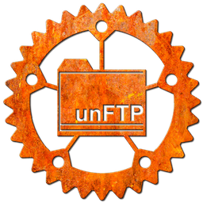

# unFTP

[](https://github.com/Cloudinvoke/unFTP/actions)
[](https://hub.docker.com/r/cloudinvoke/unftp/)
[](https://t.me/unftp)

[](https://repology.org/project/unftp/versions)

When you need to FTP, but don't want to.



[**Website**](https://unftp.rs) | [**Docs**](https://unftp.rs/server) | [**libunftp**](https://github.com/bolcom/libunftp)

unFTP is an FTP(S) server written in [Rust](https://www.rust-lang.org) and built on top
of [libunftp](https://github.com/bolcom/libunftp) and the [Tokio](https://tokio.rs) asynchronous run-time. It is **un**like your normal FTP server in that it provides:

- Configurable Authentication (e.g. Anonymous, [PAM](https://en.wikipedia.org/wiki/Linux_PAM), a JSON file or HTTP).
- Configurable storage back-ends (e.g. [GCS](https://cloud.google.com/storage/) or filesystem)
- Configurable notifications (e.g. events over [Google Pub/Sub](https://cloud.google.com/pubsub/docs/overview))
- An HTTP server with health endpoints for use for example in Kubernetes for readiness and liveness probes.
- Integration with [Prometheus](https://prometheus.io) for monitoring.
- A proxy protocol mode for use behind proxies like HA Proxy and Nginx.
- Structured logging and the ability to ship logs to [Google Cloud Logging](https://cloud.google.com/logging) or a Redis
  instance.

With unFTP, you can present RFC compliant FTP(S) to the outside world while freeing yourself to use modern APIs and
techniques on the inside of your perimeter.

unFTP is maintained under the [CloudInvoke](https://github.com/Cloudinvoke) project by
[Hannes de Jager](https://github.com/hannesdejager) and
[Rob klein Gunnewiek](https://github.com/robklg). It is no longer affiliated with bol.com.

## Installation and Usage

User documentation are available on our website [unftp.rs](https://unftp.rs)

## Provided Docker Images

The project contains templated Dockerfiles . To get a list of available commands to create them, run:

```sh
make help
```

We offer 3 different options for building an unFTP docker image:

- `scratch`: builds the binary in [rust:slim](https://hub.docker.com/_/rust) and deploys in a `FROM scratch` image. The
  unFTP binary is statically linked using [musl libc](https://www.musl-libc.org/).
- `alpine` (default): builds in [rust:slim](https://hub.docker.com/_/rust) and deploy in alpine. This image is built
  with musl instead of a full-blown libc. The unFTP binary is statically linked
  using [musl libc](https://www.musl-libc.org/).
- `alpine-debug`: same images as `alpine` but using the debug build of unftp and adds tools
  like [lftp](https://lftp.yar.ru/) and [CurlFtpFS](http://curlftpfs.sourceforge.net/) while also running as root.

To build the alpine docker image:

```sh
make docker-image-alpine
```

Starting with v0.16.0, pre-made images will be published to
[Docker Hub](https://hub.docker.com/r/cloudinvoke/unftp/tags) as `cloudinvoke/unftp`
and to GitHub Container Registry as `ghcr.io/cloudinvoke/unftp`.
Older images remain available from the former
[Docker Hub repository](https://hub.docker.com/r/bolcom/unftp/tags).
See [the Docker section on the unftp.rs website](https://unftp.rs/server/docker).

## Selective compiling

The unFTP `Cargo.toml` file lists features that allows enabling or disabling storage and authentication back-ends.

These are the default ones: "auth_rest", "sbe_gcs", "auth_jsonfile", "sbe_opendal".

The binary called `unftp_x86_64-unknown-linux-gnu` that we provide via the unFTP GitHub releases also enables
`auth_pam`.

### 📦 Storage Back-end Extensions

| Feature       | Description                                                                                                            |
|---------------|------------------------------------------------------------------------------------------------------------------------|
| `sbe_azblob`  | Enables Azure Blob Storage support via [`unftp-sbe-opendal`](https://crates.io/crates/unftp-sbe-opendal).              |
| `sbe_gcs`     | Enables Google Cloud Storage support via [`unftp-sbe-gcs`](https://crates.io/crates/unftp-sbe-gcs).                    |
| `sbe_iso`     | Enables serving ISO 9660 images as FTP storage backends via [`unftp-sbe-iso`](https://crates.io/crates/unftp-sbe-iso). |
| `sbe_opendal` | Enables generic cloud storage support using [`unftp-sbe-opendal`](https://crates.io/crates/unftp-sbe-opendal).         |

### 🔐 Auth Back-end Extensions

| Feature         | Description                                                                                                              |
|-----------------|--------------------------------------------------------------------------------------------------------------------------|
| `auth_jsonfile` | Enables authentication from a local JSON file via [`unftp-auth-jsonfile`](https://crates.io/crates/unftp-auth-jsonfile). |
| `auth_pam`      | Enables authentication via PAM using [`unftp-auth-pam`](https://crates.io/crates/unftp-auth-pam).                        |
| `auth_rest`     | Enables HTTP-based authentication using [`unftp-auth-rest`](https://crates.io/crates/unftp-auth-rest).                   |

## Getting help and staying informed

Support is given on a best effort basis. You are welcome to engage us
on [the discussions page](https://github.com/Cloudinvoke/unFTP/discussions)
or create a Github issue.

You can also follow news and talk to us on [Telegram](https://t.me/unftp)

## Updating user documentation

Make your edits in docs/

If you want to preview the docs:

- Install Doctave as explained in the README at https://github.com/Doctave/doctave
- Run `make site-preview`

To publish the documentation, merge your changes, update your local
`master`, and ensure it has no uncommitted tracked changes. Then run
`make site`.
This requires Doctave and permission to push to the `netlify` branch. The
publishing script builds the site, commits the generated files on that
branch, and pushes it; Netlify then deploys unftp.rs.
The script keeps your `master` checkout and its untracked files intact. If it
fails after building, it leaves `site/` for inspection; move or remove that
directory before retrying.

## License

You're free to use, modify and distribute this software under the terms of the Apache-2.0 license.

## See also

- [libunftp](https://github.com/bolcom/libunftp), the primary crate unFTP server is based on.
- [libunftp back-ends/extensions on crates.io](https://crates.io/search?q=unftp-)
